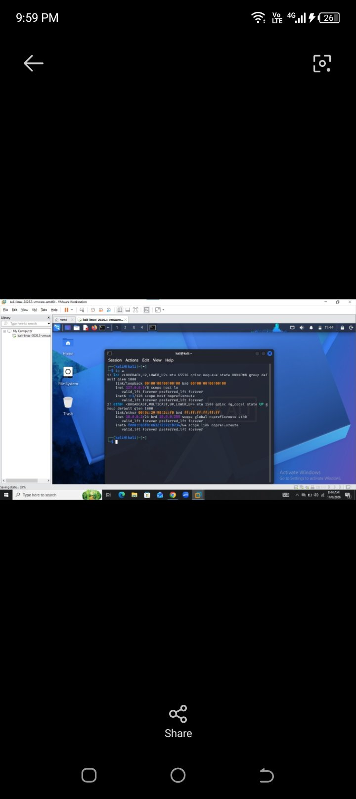
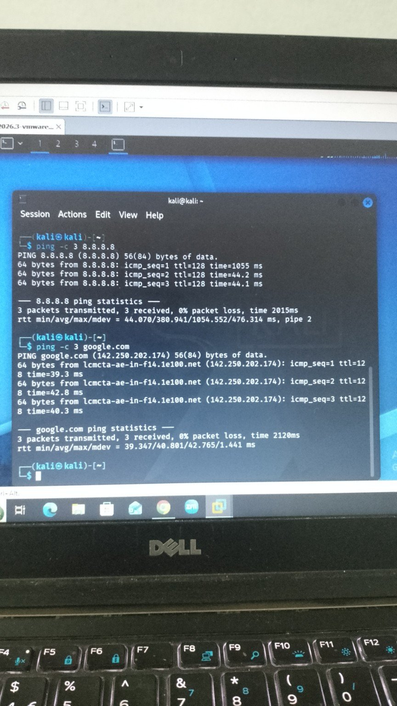
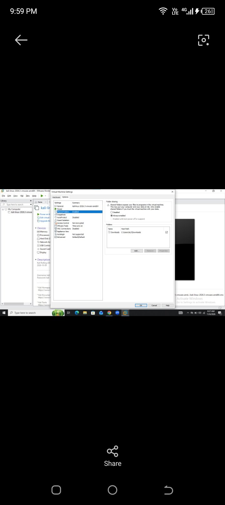
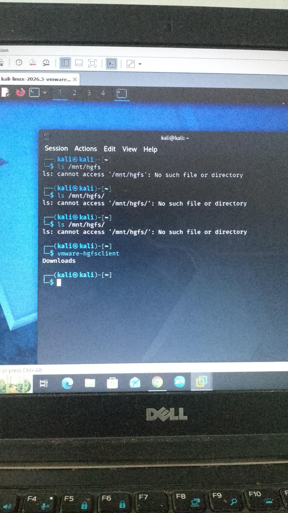
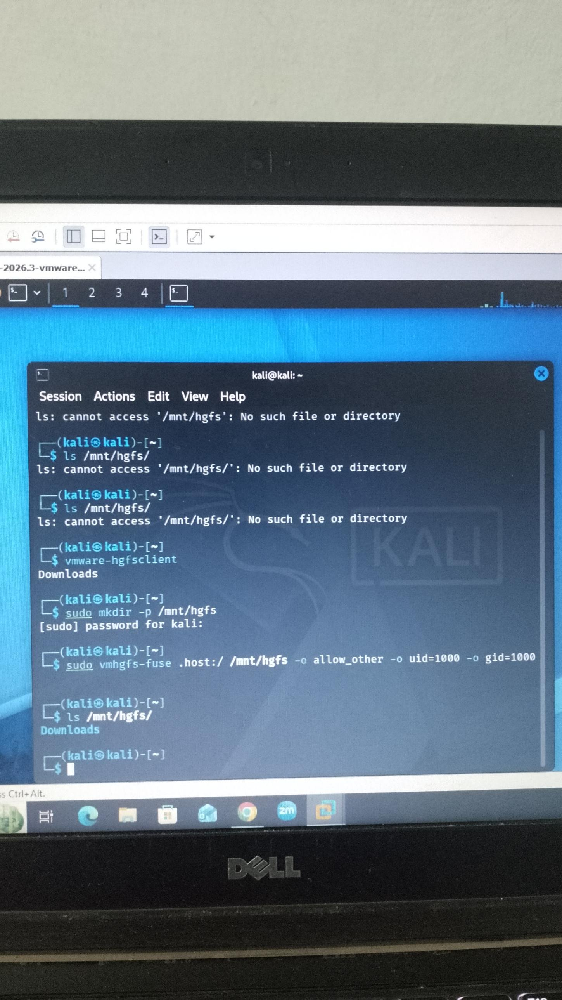
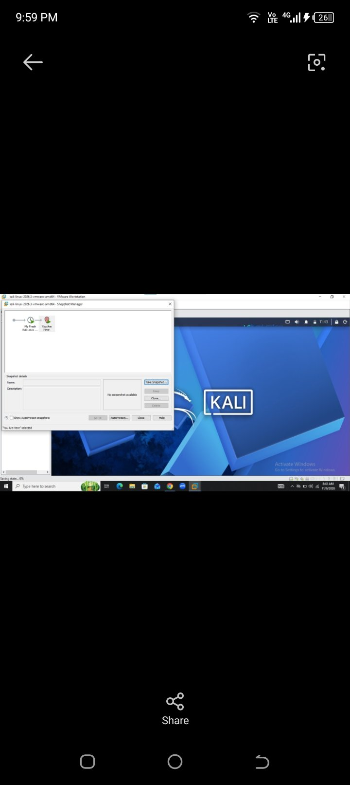

# week1-kali-vmware-lab
Week 1 practical lab setup: Kali Linux on VMware Workstation with NAT network 10.0.0.0/24, static IP 10.0.0.2/24, shared folder, clipboard/drag-drop and snapshot.
# Week 1 – Practical Lab Environment Setup (Kali Linux on VMware)

**Author:** Bisma · **Date:** Nov 6, 2026

## Task and requirements

The task was to build a cybersecurity testing lab with Kali Linux as the attacking machine. All seven requirements are met. VMware Workstation was used instead of VirtualBox, which the course FAQ allows as a last option.

| # | Requirement | How it was met | Status |
|---|-------------|----------------|--------|
| 1 | Hypervisor (latest version) | VMware Workstation on Windows | Done |
| 2 | Kali Linux as attacker VM (latest) | kali-linux-2026.3-vmware-amd64 | Done |
| 3 | Isolated network, 10.0.0.0/24 | VMware NAT network, subnet 10.0.0.0/24 | Done |
| 4 | Clipboard and drag/drop enabled | Guest Isolation options ticked, `open-vm-tools-desktop` installed | Done |
| 5 | Shared folder with host Downloads | `C:\Users\ALI\Downloads` shared, mounted at `/mnt/hgfs` | Done |
| 6 | Kali IP 10.0.0.2/24 | Static IP set with `nmcli` | Done |
| 7 | Full Internet access | `ping` to 8.8.8.8 and google.com succeeds | Done |

## Lab environment

| Item | Value |
|------|-------|
| Host OS | Windows (Dell laptop) |
| Hypervisor | VMware Workstation |
| Guest OS | Kali Linux 2026.3 (`kali-linux-2026.3-vmware-amd64`) |
| Network mode | NAT, subnet 10.0.0.0/24 |
| Kali IP address | 10.0.0.2/24 (static) |
| Gateway | 10.0.0.254 |
| DNS server | 8.8.8.8 |
| Shared folder | `C:\Users\ALI\Downloads`, mounted in Kali at `/mnt/hgfs/Downloads` |

## Network setup: static IP and Internet

Kali first received 10.0.0.100/24 from DHCP and already had Internet. It was then changed to the required static address 10.0.0.2/24.

1. Set the static IP, gateway and DNS:

```bash
sudo nmcli connection modify "Wired connection 1" ipv4.method manual ipv4.addresses 10.0.0.2/24 ipv4.gateway 10.0.0.254 ipv4.dns 8.8.8.8
```

2. Restart the connection so the change applies:

```bash
sudo nmcli connection down "Wired connection 1"
sudo nmcli connection up "Wired connection 1"
```

3. Confirm the IP address. The output must show `inet 10.0.0.2/24` on `eth0`:

```bash
ip a
```



4. Confirm Internet access and DNS:

```bash
ping -c 3 8.8.8.8
ping -c 3 google.com
```



## Clipboard, drag and drop, and shared folder

These features need VMware Tools inside Kali, so `open-vm-tools-desktop` was installed first.

1. Install VMware Tools in Kali and reboot:

```bash
sudo apt update
sudo apt install -y open-vm-tools-desktop
sudo reboot
```

2. Shut the VM down. In VMware open **VM → Settings → Options → Guest Isolation** and tick both **Enable drag and drop** and **Enable copy and paste**.

<!-- TODO: add Guest Isolation screenshot as images/04-guest-isolation.jpg -->

3. In **Options → Shared Folders**, select **Always enabled** and add the Windows folder `C:\Users\ALI\Downloads`.



4. Start Kali and mount the share:

```bash
vmware-hgfsclient
sudo mkdir -p /mnt/hgfs
sudo vmhgfs-fuse .host:/ /mnt/hgfs -o allow_other -o uid=1000 -o gid=1000
ls /mnt/hgfs/
ls /mnt/hgfs/Downloads
```

`vmware-hgfsclient` lists `Downloads`, and the last two commands show the host files inside Kali.





5. Test the clipboard by copying text in Windows and pasting it in Kali. Test drag and drop by dragging a file from Windows onto the Kali desktop.

<!-- TODO: add clipboard / drag-drop screenshot as images/07-clipboard-dragdrop.jpg -->

## Snapshot of the VM

A snapshot was taken after all settings worked, so the lab can be restored to this clean state at any time.

1. In VMware Workstation select the Kali VM.
2. Click **VM → Snapshot → Take Snapshot**.
3. Name it `My Fresh Kali Linux after installation` and click **Take Snapshot**.
4. Open **VM → Snapshot → Snapshot Manager** to confirm it is listed.



## Troubleshooting and conclusion

Two problems came up during setup and both were fixed.

| Problem | Cause | Fix |
|---------|-------|-----|
| `ls: cannot access '/mnt/hgfs'` | The folder did not exist and the share was not mounted | Created `/mnt/hgfs` and mounted it with `vmhgfs-fuse` |
| `nmcli: method 'manual' requires at least an address` | The command was run without an IP address | Ran it again with `ipv4.addresses 10.0.0.2/24` and the gateway |

If the Internet stops working after the IP change, set the DNS server to the gateway instead:

```bash
sudo nmcli connection modify "Wired connection 1" ipv4.dns 10.0.0.254
sudo nmcli connection down "Wired connection 1"
sudo nmcli connection up "Wired connection 1"
```

The shared folder mount is lost after a reboot. To make it permanent, add it to `/etc/fstab`:

```bash
echo '.host:/ /mnt/hgfs fuse.vmhgfs-fuse allow_other,uid=1000,gid=1000,nofail 0 0' | sudo tee -a /etc/fstab
```

**Conclusion:** The Kali Linux lab on VMware Workstation is ready for hands-on practice. It has the static IP 10.0.0.2/24, full Internet access, clipboard and drag/drop, a shared Downloads folder, and a saved snapshot.
